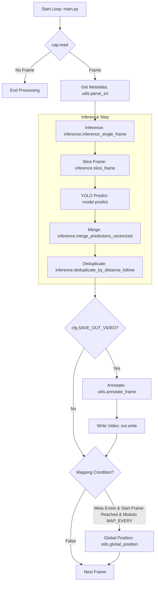

# Cabbage Detection Pipeline Execution Analysis

This document provides a detailed execution graph and complexity analysis for the video processing pipeline found in `main.py` and its dependencies.

## Execution Flow Diagram

The following diagram illustrates the flow of data for a single frame within the main processing loop.

## Function Analysis & Complexity

The following table details the functions involved in the processing of each frame, their execution frequency, and estimated computational cost.

| Function | Module | Frequency | Estimated Cost | Description |
| :--- | :--- | :--- | :--- | :--- |
| `cap.read` | `opencv` | Every Frame | Low | Reads the next frame from the video file. |
| `frame_meta.get` | `dict` | Every Frame | Negligible | O(1) Dictionary lookup for GPS metadata. |
| `inference_single_frame` | `inference` | Every Frame | **Very High** | Orchestrates the entire detection process. |
| `slice_frame` | `inference` | Every Frame | Medium | Slices (H, W) image into tiles. Copy operations involved. Complexity scales with image resolution. |
| `model.predict` | `ultralytics` | Every Frame | **Very High** | Runs the TensorRT engine. The most expensive operation. Scales with number of slices (capped at 8). |
| `merge_predictions_vectorized` | `inference` | Every Frame | Low | Vectorized numpy/torch operations to adjust box coordinates. |
| `deduplicate_by_distance_kdtree` | `inference` | Every Frame | Low/Medium | Builds KDTree and queries radius. Efficient (O(N log N)), but N is usually small (<100). |
| `annotate_frame` | `utils` | Every Frame (if enabled) | Low | Draws rectangles and text on the image using OpenCV. Linear to number of detections. |
| `out.write` | `opencv` | Every Frame (if enabled) | Medium | Encodes and writes the frame to disk. |
| `global_position` | `utils` | Conditional (Every `MAP_EVERY` frames) | Low | Trigonometric calculations for each detection to find Lat/Lon. Linear to number of detections. |

## Critical Path

The bottleneck of the application is **`model.predict`** inside `inference_single_frame`. 
- **Slicing**: The slicing strategy increases the workload for the model by generating multiple inputs per frame.
- **Safety Limit**: The code currently hard-limits slices to 8 (`slices[:8]`), which caps the maximum cost but may result in missed detections in the bottom/right parts of high-resolution images if they exceed the slice coverage.

## Mapping Logic
Mapping (`global_position`) runs less frequently than detection, governed by `cfg.MAP_EVERY`. This decoupling allows for high-fps video generation (if needed) while only sampling GPS points occasionally to avoid overcrowding the map data, although currently `inference` still runs every frame regardless of whether mapping is active for that frame.

## Optimization Opportunities
1. **Skip Inference**: If the goal is only mapping, `inference_single_frame` could be skipped entirely for frames where `global_position` is not called, unless the video output requires every frame to be annotated.
2. **Batch Processing**: Slices are passed as a list to `model.predict`. Increasing batch size might improve throughput on supported GPUs.
